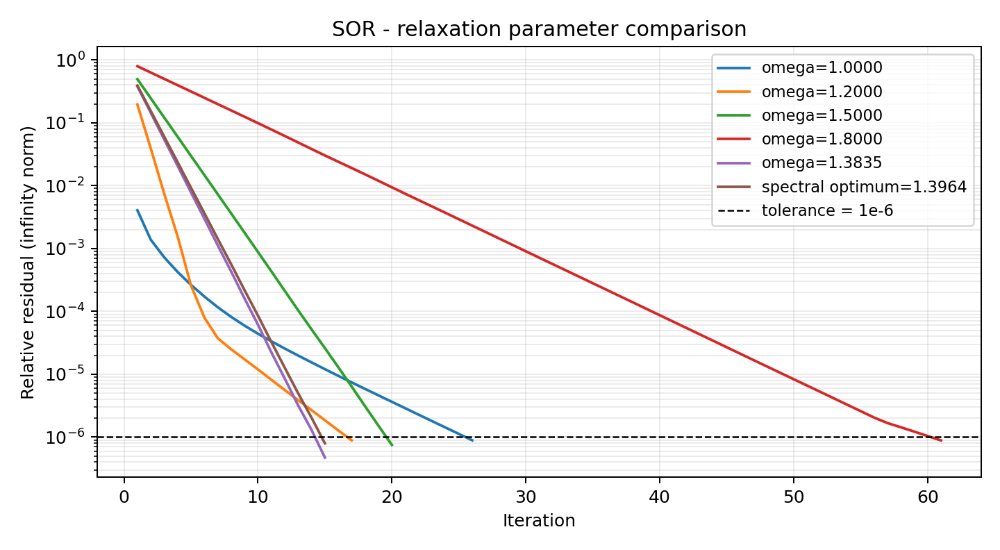
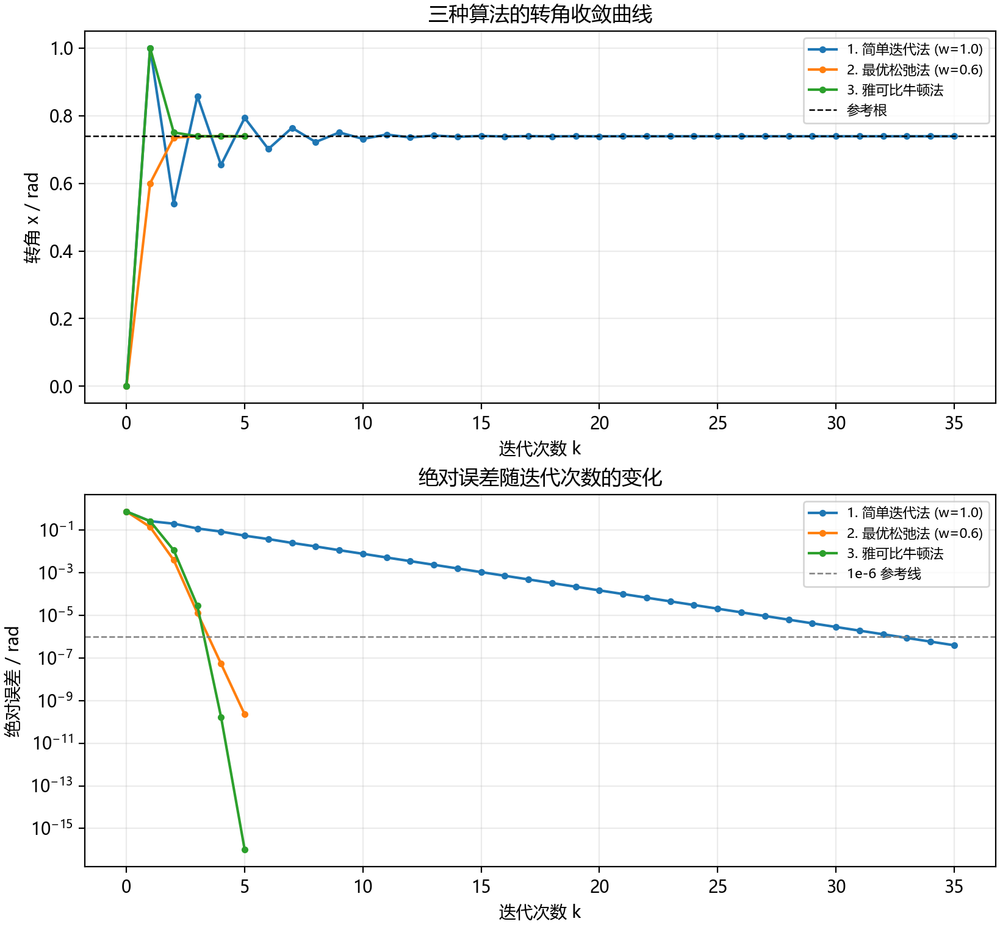

# 数值计算与最优化实验

两次数值计算课程实验的代码、已运行 Notebook、输入数据、收敛图和 Word 报告。
重点是统一比较准则、保存可复核结果，并区分公式预测、参数网格搜索和实际数值验证。

本仓库为课程实践展示，使用 AI 辅助完成代码与报告整理，不作为科研论文或原创算法成果。

## 实验内容

| 实验 | 问题与方法 | 可复核内容 |
| --- | --- | --- |
| [实验一](experiment-01/) | 线性方程组：NumPy 直接法、部分选主元 LU、Jacobi、SOR | 无穷范数残差、条件数、参数扫描、病态矩阵及右端扰动 |
| [实验二](experiment-02/) | 非线性方程 `x - cos(x) = 0`：简单迭代、松弛迭代、Newton | 统一停止准则、规定网格寻优、奇异初值保护及二分交叉核验 |

## 运行方式

建议 Python 3.12。在仓库根目录安装依赖：

```bash
git clone https://github.com/CQU-WCJ/numerical-analysis-labs.git
cd numerical-analysis-labs
python -m pip install -r requirements.txt
```

实验一需要同目录的两份 NPZ 数据，必须完整克隆仓库：

```bash
cd experiment-01
python experiment1.py
```

结果写入 `experiment-01/results/`，包括详细 JSON、四张曲线和运行日志。
完整 SOR 网格与谱半径扫描需要一定时间，耗时取决于硬件和数值库配置。

另开终端，在实验二目录运行：

```bash
cd experiment-02
python experiment2.py
```

实验二会打印结果并显示图像，图像窗口关闭后继续执行；图片保存于实验二目录。
无界面环境可设置 `MPLBACKEND=Agg`；Windows PowerShell 使用 `$env:MPLBACKEND="Agg"`。
中文绘图建议安装微软雅黑或黑体；缺少中文字体可能出现方框，不影响数值计算。

Notebook 可以直接在 GitHub 阅读已保存输出；交互运行可另行安装 JupyterLab，
在对应实验目录打开 `.ipynb` 并从头运行全部单元。

## 比较准则与结果

实验一以零向量为迭代初值，使用相对无穷范数残差 `< 1e-6` 作为停止条件。
SOR 经典公式候选、实际谱半径数值最优与有限步网格最优分别计算，不能混为同一最优值。
病态矩阵的 Jacobi 最多执行 200 次；达到次数上限不等于收敛。
详细结果见 [实验一结果 JSON](experiment-01/results/results.json)。

实验二以 `x0=0`、相邻迭代值差 `< 1e-6` 为统一停止准则，并检查最终残差与根误差：

| 方法 | 更新次数 | 备注 |
| --- | ---: | --- |
| 简单迭代 | 35 | `omega=1` |
| 松弛迭代 | 5 | 规定网格 `0.4, 0.5, 0.6, 0.7` 中选出 `omega=0.6` |
| Newton | 5 | 正常初值 |
| 带保护 Newton | 6 | 从 `-pi/2` 出发，导数近零时回退为简单迭代 |

参考根约为 `0.7390851332151607`。这里的次数是迭代更新次数，不是毫秒。
本次代码与 Notebook 重跑记录见 [验证记录](VALIDATION.md)。





## 文件结构

```text
experiment-01/
  experiment1.py / experiment1.ipynb
  cloth_data.npz / cloth_ill_data.npz
  experiment1_report.docx
  results/
experiment-02/
  experiment2.py / experiment2.ipynb
  experiment2_report.docx
  convergence.png / damping_search.png
```

Word 报告保留原课程模板结构，公开副本已清理姓名、学号、班级及地点等个人字段；
源报告未修改。报告是原实验运行时的记录，不会随脚本重跑自动更新。
计时结果受机器负载、BLAS 实现与线程数影响，不适合直接作跨机器性能排名。

原课程输入数据用于本课程实验复现，仓库不包含完整课程讲义。
本仓库未额外授予原课程材料或数据的再许可。
